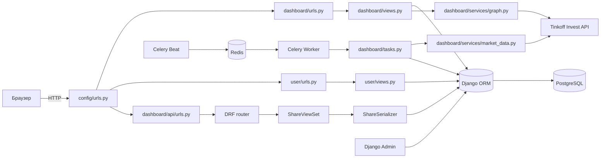
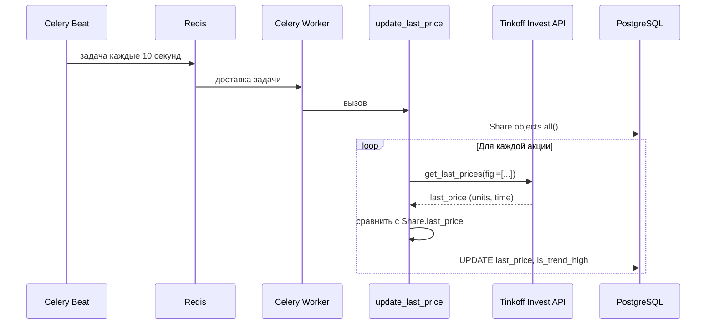
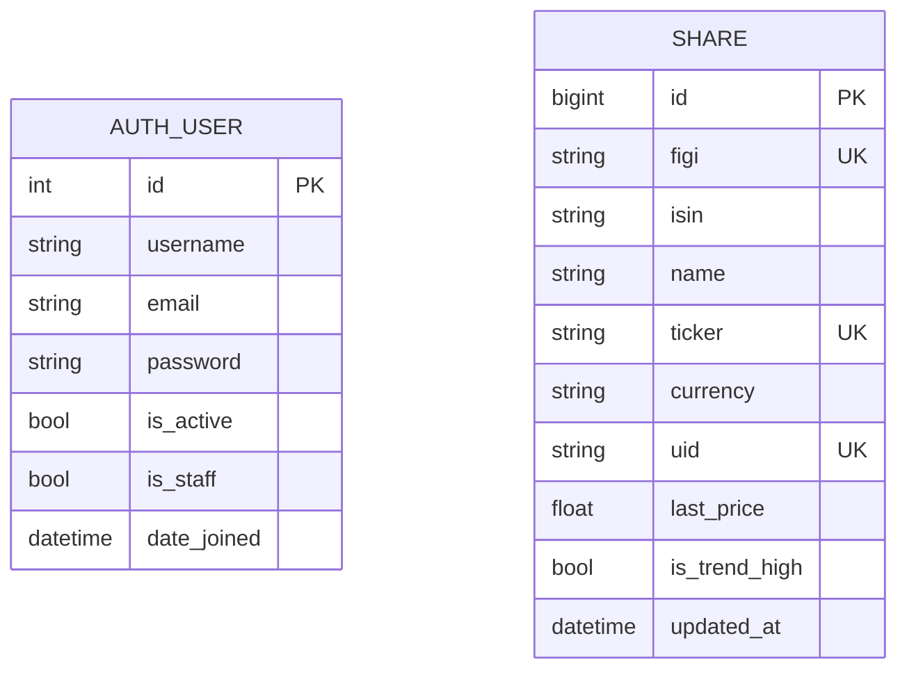

# Анализ проекта Investing Demo и восстановленные функциональные требования

**Объект анализа:** исходное состояние репозитория `aidd-topic-03-homework`, коммит `362510b` (ветка `main`).
**Метод:** статический анализ исходного кода, миграций, конфигурации и шаблонов; проверка фактических зависимостей; попытка запуска исходной версии в текущем окружении.
**Дата:** 01.11.2026.

> Важно: документ описывает **исходную** версию приложения. Исправления, выполнение
> которых предусмотрено заданием №3, и новая функциональность задания №4 описаны
> отдельно в `MODERNIZATION.md` и `FEATURES.md`; в разделе требований они не
> выдаются за существующие возможности.

## 1. Назначение приложения и технологический стек

Investing Demo — учебное веб-приложение для просмотра акций и их рыночных цен.
Приложение позволяет:

- просматривать справочник акций;
- открывать карточку акции с текущей ценой и графиком за 180 дней;
- регистрировать пользователя по e-mail и выполнять вход/выход;
- авторизованным пользователям добавлять, редактировать и удалять акции;
- работать со справочником через REST API;
- периодически обновлять последние цены через Celery и Tinkoff Invest API;
- загружать список акций из Tinkoff Invest API management-командой;
- администрировать акции через стандартную админку Django.

Технологический стек исходной версии:

| Слой | Технология | Фактическое использование |
|---|---|---|
| Язык | Python | версия в проекте не зафиксирована; зависимости рассчитаны на Python 3.8–3.11 |
| Web-фреймворк | Django 4.1.7 | MVT, ORM, admin, auth, sessions, messages |
| API | Django REST Framework 3.14.0 | `ModelViewSet`, сериализаторы, фильтры, пагинация |
| Фильтрация API | django-filter 22.1 | фильтр по `name`, `ticker`; поиск и сортировка |
| Формы | django-crispy-forms 2.0 + crispy-bootstrap3 | вывод форм в шаблонах |
| Асинхронные задачи | Celery 5.2.7 | задача обновления цен, beat-расписание |
| Брокер задач | Redis 4.5.1 | `redis://127.0.0.1:6379/0` |
| БД | PostgreSQL | `psycopg2-binary` 2.9.5, жёстко заданное подключение |
| Внешние данные | Tinkoff Invest API | `tinkoff-investments==0.2.0b50` |
| Графики | Plotly 5.13.1 | серверная генерация HTML-разметки графика |
| Frontend | Bootstrap 5.1.3, jQuery, Moment.js, Font Awesome | статические файлы и CDN |
| Тесты | Django TestCase / DRF APITestCase | 10 API-тестов в `dashboard/tests.py` |
| Контейнеры | Docker Compose | только PostgreSQL и Redis; приложение не контейнеризировано |

## 2. Структура проекта

Исходный репозиторий содержит 61 файл (без `.git`), из них 966 строк Python-кода.

```
.
├── config/                     # конфигурация Django-проекта
│   ├── __init__.py             # импорт Celery-приложения
│   ├── settings.py             # настройки, БД, логирование, Celery, токен
│   ├── urls.py                 # корневая маршрутизация
│   ├── celery.py               # Celery app и beat-расписание
│   ├── asgi.py / wsgi.py       # точки входа ASGI/WSGI
│   └── ...
├── dashboard/                  # домен «акции и рыночные данные»
│   ├── models.py               # модель Share
│   ├── views.py                # HTML CRUD и карточка акции
│   ├── forms.py                # ShareModelForm
│   ├── urls.py                 # HTML-маршруты + подключение API
│   ├── admin.py                # регистрация Share в админке
│   ├── tasks.py                # Celery-задача update_last_price
│   ├── tests.py                # 10 тестов REST API
│   ├── api/v1/                 # DRF router, ViewSet, serializer
│   ├── services/
│   │   ├── market_data.py      # получение последней цены из Tinkoff
│   │   └── graph.py            # построение графика через Plotly
│   ├── management/commands/
│   │   └── add_shares.py       # импорт акций из Tinkoff
│   ├── migrations/             # 7 миграций (0001–0007)
│   ├── static/dashboard/       # Bootstrap 5.1.3 и стили
│   └── templates/dashboard/    # base, list, detail, create, delete
├── user/                       # домен «пользователи»
│   ├── forms.py                # RegistrationForm, AuthForm
│   ├── views.py                # AuthView, RegistrationView, LogoutView
│   ├── urls.py                 # /user/login, /user/registration, /user/logout
│   ├── models.py               # алиас на get_user_model()
│   ├── templates/user/         # base, auth, registration
│   └── static/user/            # копия bootstrap.min.css, signin.css
├── docker-compose.yml          # PostgreSQL + Redis
├── requirements.txt            # 40 зафиксированных зависимостей
├── README.md                   # краткая инструкция запуска
└── HOMEWORK.md                 # текст задания
```

## 3. Архитектура и взаимодействие компонентов

### 3.1. Общая схема

Приложение построено по схеме Django MTV (Model–Template–View) с отдельным
REST API и фоновым worker-ом Celery. Выделенного сервисного слоя для акций нет:
HTML-представления и API обращаются к ORM напрямую. Вспомогательная логика
вынесена в `dashboard/services/` и `dashboard/tasks.py`.



### 3.2. Обработка HTML-запроса

1. `config/urls.py` направляет корневые адреса в `dashboard.urls`, адреса
   `/user...` — в `user.urls`, `/admin/` — в стандартную админку.
2. `dashboard.urls` сопоставляет:
   - `/` → `ShareListView`;
   - `/<int:pk>` → `ShareDetailView`;
   - `/create` → `ShareCreateView`;
   - `/update/<int:pk>` → `ShareUpdateView`;
   - `/delete/<int:pk>` → `ShareDeleteView`;
   - `/api/` → API.
3. `ShareListView` — `ListView` с `paginate_by=100` и сортировкой по `name`.
4. `ShareDetailView` — обычный `View` с методом `get`; получает `Share` через
   `Share.objects.get(id=pk)`, вызывает `get_graph(share)` и рендерит
   `dashboard/detail.html`.
5. `ShareCreateView`, `ShareUpdateView`, `ShareDeleteView` наследуются от
   `CreateView`, `UpdateView`, `DeleteView` и используют миксин
   `IsUserAuthenticatedMixin`.
6. Шаблоны наследуются от `dashboard/base.html`; список и карточка доступны
   без авторизации.

### 3.3. Аутентификация и авторизация

- Пользователи — стандартная модель `django.contrib.auth.models.User`.
  Собственной модели пользователя нет: `user/models.py` содержит только
  `User = get_user_model()`.
- `RegistrationForm` — обычная `forms.Form`, не `ModelForm`. Поля: `email`,
  `password1`, `password2`. При сохранении вызывается
  `User.objects.create_user(email, email, password)`: e-mail используется и как
  `username`, и как `email`.
- `AuthView.post` вызывает `authenticate(username=email.lower(), password=...)`.
- `RegistrationView.post` после успешной регистрации сразу выполняет `login`.
- `LogoutView.get` выполняет `logout` и перенаправляет на главную.
- HTML-операции создания/редактирования/удаления защищены проверкой
  `request.user.is_authenticated`; при отказе выполняется `redirect` на главную,
  а не переход на страницу входа.
- REST API не имеет явных permission-классов: `ShareViewSet` наследует
  настройки DRF по умолчанию, то есть `AllowAny`. Чтение и запись через API
  доступны без аутентификации.

### 3.4. REST API

- `dashboard/api/urls.py` подключает `v1/`.
- `dashboard/api/v1/urls.py` подключает `DefaultRouter`.
- `router.py` регистрирует `shares` → `ShareViewSet`.
- `ShareViewSet` — `ModelViewSet` с `queryset = Share.objects.all()`,
  фильтрами `OrderingFilter`, `DjangoFilterBackend`, `SearchFilter`.
- `ShareFilter` разрешает фильтрацию по `name` и `ticker`.
- `ordering_fields = ["name", "ticker"]`.
- `search_fields = ["$name"]` — поиск по регулярному выражению в `name`.
- Пагинация задана глобально: `LimitOffsetPagination`, `PAGE_SIZE=100`.
- Сериализатор отдаёт `id`, `figi`, `isin`, `name`, `ticker`, `currency`,
  `last_price`, `is_trend_high`, `updated_at`; поле `uid` не отдаётся.

### 3.5. Фоновое обновление цен



Фактически:

- `config/celery.py` регистрирует beat-задачу с именем `add-every-5-min`, но
  `schedule` равен `10.0` секунд — расхождение с названием и комментарием.
- `dashboard/tasks.py::update_last_price` перебирает все `Share` и для каждой
  отдельно вызывает `get_last_data`.
- `get_last_data` создаёт новый `Client` Tinkoff на каждую акцию, получает
  `last_prices`, берёт последний элемент и возвращает `[price.units, time]`.
- `tasks.py` сравнивает `share.last_price > last_price`; при равенстве
  выставляет `is_trend_high=True`; при `None`/ошибке — тоже `True`.
- Обновление выполняется через `Share.objects.filter(...).update(...)`, поэтому
  `updated_at` с `auto_now=True` не обновляется.
- Ошибки логируются и не прерывают обработку остальных акций.
- Задача не создаёт историю цен: сохраняется только последняя цена.

### 3.6. Построение графика

- `ShareDetailView` вызывает `get_graph(share)` при каждом открытии карточки.
- `get_graph` открывает Tinkoff-клиент, запрашивает дневные свечи за 180 дней
  (`get_all_candles`, `CANDLE_INTERVAL_DAY`), формирует списки дат и цен.
- Используется только `candle.close.units`; дробная часть (`nano`) игнорируется.
- Plotly генерирует HTML `<div>` на сервере (`plot(..., output_type="div")`).
- Внешний запрос выполняется синхронно в обработчике HTTP-запроса; кэша и
  сохранённой истории нет. При отсутствии токена/сети карточка падает.

### 3.7. Импорт акций

- `python manage.py add_shares` открывает Tinkoff-клиент, получает
  `client.instruments.shares()` и перебирает инструменты.
- Для каждой акции вызывается
  `Share.objects.get_or_create(figi=..., name=..., isin=..., ticker=..., currency=..., uid=...)`.
- Такой lookup включает все поля, поэтому изменение любого атрибута у уже
  существующей акции приводит к попытке создания новой записи и нарушению
  уникальности `figi`/`ticker`/`uid`.

## 4. Используемые библиотеки и внешние зависимости

### 4.1. Прямые зависимости

| Пакет | Версия | Назначение | Состояние на 01.11.2026 |
|---|---:|---|---|
| Django | 4.1.7 | web-фреймворк | EOL, не поддерживается |
| djangorestframework | 3.14.0 | REST API | устарел |
| django-filter | 22.1 | фильтры API | устарел |
| django-crispy-forms | 2.0 | формы | устарел |
| crispy-bootstrap3 | 2022.1 | шаблоны crispy для Bootstrap 3 | не соответствует Bootstrap 5 в статике |
| celery | 5.2.7 | фоновые задачи | устарел |
| redis | 4.5.1 | клиент Redis | устарел |
| psycopg2-binary | 2.9.5 | драйвер PostgreSQL | устарел; не рекомендуется для production |
| plotly | 5.13.1 | графики | устарел |
| tinkoff-investments | 0.2.0b50 | SDK Tinkoff Invest | удалён из PyPI, репозиторий архивирован |
| tinkoff | 0.1.1 | транзитивная/legacy-зависимость SDK | не используется напрямую |
| grpcio | 1.51.3 | gRPC-транспорт | устарел; ограничивает Python |
| protobuf | 3.20.3 | protobuf-сообщения | устарел |
| pydantic | 1.10.6 | не импортируется в коде | лишняя зависимость |
| black | 23.1.0 | форматирование | dev-инструмент в runtime-файле |
| isort | 5.12.0 | сортировка импортов | dev-инструмент в runtime-файле |
| tomli | 2.0.1 | парсинг TOML | dev/транзитивная |
| mypy-extensions | 1.0.0 | типы | dev/транзитивная |

### 4.2. Транзитивные зависимости

`amqp`, `asgiref`, `async-timeout`, `billiard`, `cachetools`, `click`,
`click-didyoumean`, `click-plugins`, `click-repl`, `kombu`, `packaging`,
`pathspec`, `platformdirs`, `prompt-toolkit`, `python-dateutil`, `pytz`, `six`,
`sqlparse`, `tenacity`, `typing_extensions`, `vine`, `wcwidth`.

Часть из них не используется приложением напрямую и попала в `requirements.txt`
как результат `pip freeze`. Версии зафиксированы без разделения runtime/dev и без
указания совместимой версии Python.

### 4.3. Внешние сервисы и инфраструктура

- **Tinkoff Invest API** — gRPC-сервис, требует токен `TINKOFF_TOKEN`.
  В исходном коде токен хранится в `config/settings.py` и пуст.
- **Redis** — брокер Celery; в `docker-compose.yml` описан сервис `redis`.
- **PostgreSQL** — основная БД; параметры подключения жёстко заданы:
  `investing/postgres/postgres@localhost:5432`.
- **CDN** — Plotly, jQuery, Moment.js, Font Awesome, Tempus Dominus;
  версии не зафиксированы (Plotly `latest`).

### 4.4. Вывод по зависимостям

Исходный проект не устанавливается в современном окружении:

- `tinkoff-investments==0.2.0b50` отсутствует на PyPI (пакет удалён/помещён в
  карантин), официальный GitHub-репозиторий архивирован;
- Django 4.1 не поддерживает Python 3.13;
- `psycopg2-binary` и старые `grpcio`/`protobuf` не имеют колёс для Python 3.13;
- часть зависимостей является мусором от `pip freeze`;
- dev-инструменты (`black`, `isort`) находятся в production-файле.

Официальная замена SDK — пакет `t-tech-investments` (T-Invest Python SDK),
распространяемый через реестр T-Bank, с импортом `t_tech.invest`. Он
поддерживает Python 3.8+ и совместим с Python 3.13. Это используется в
задании №3; в исходной версии он, разумеется, не применяется.

## 5. Модель данных

### 5.1. Сущности

В исходной версии есть одна доменная модель — `Share` (акция). Пользователи
хранятся в стандартной таблице `auth_user`.



### 5.2. Атрибуты `Share`

| Поле | Тип | Ограничения | Назначение |
|---|---|---|---|
| `id` | `BigAutoField` | PK | Идентификатор |
| `figi` | `CharField(255)` | unique, not null | FIGI инструмента |
| `isin` | `CharField(255)` | not null | ISIN инструмента |
| `name` | `CharField(255)` | not null | Наименование компании |
| `ticker` | `CharField(10)` | unique, not null | Биржевой тикер |
| `currency` | `CharField(20)` | not null | Валюта цены |
| `uid` | `CharField(255)` | unique, not null | UID инструмента в Tinkoff |
| `last_price` | `FloatField` | null, blank | Последняя цена |
| `is_trend_high` | `BooleanField` | null, blank | Признак роста цены |
| `updated_at` | `DateTimeField` | auto_now, null, blank | Время обновления |

`Meta`: `verbose_name = "Акция"`, `verbose_name_plural = "Акции"`.
Сортировка по умолчанию не задана; список сортируется во view.

### 5.3. Миграции

| Миграция | Содержание |
|---|---|
| `0001_add_share` | создание `Share` с `figi`, `isin`, `name`, `ticker`, `currency` |
| `0002_update_share` | unique для `figi`, `ticker` |
| `0003_add_uuid` | добавление `uid` (unique, default `""`) |
| `0004_add_last_price` | `last_price`, `is_trend_high`; промежуточные verbose_name |
| `0005_add_verbose_name` | исправление `name.verbose_name` |
| `0006_add_verbose_name` | исправление `ticker.verbose_name` |
| `0007_add_updated_at` | добавление `updated_at` |

Миграции 0003–0006 содержат следы ручных ошибок: `uid` с `default=""` при
`unique=True`, временные verbose_name `"Валюта"`/`"Ти"`, исправленные
следующими миграциями. На чистой БД это работает, но история миграций
загрязнена.

### 5.4. Пользователь

- Используется `django.contrib.auth.models.User`.
- `username` = e-mail (в нижнем регистре при создании).
- `email` = тот же e-mail.
- Уникальность e-mail на уровне БД не гарантирована; проверка выполняется
  только в `RegistrationForm.clean`.
- Пароль хранится в виде хеша; парольные валидаторы Django в кастомной форме
  явно не вызываются, хотя настройки `AUTH_PASSWORD_VALIDATORS` заданы.

### 5.5. Связи

В исходной модели связей между сущностями нет: `Share` не связан с
пользователем. Все пользователи видят один общий справочник; API не разделяет
данные по владельцам. Это важно для новой функциональности задания №4, где
потребуются персональные списки, портфели и стратегии.

## 6. Механизмы обработки запросов и работы с БД

### 6.1. Маршрутизация

- Корневой `config.urls`: admin, dashboard, user.
- Пространства имён: `dashboard`, `user`.
- API: `/api/v1/shares/` и `/api/v1/shares/<id>/`.
- URL-шаблоны не имеют завершающих слэшей у HTML-маршрутов (`/create`,
  `/update/<pk>`), что не мешает `reverse`, но отличается от типового стиля
  Django.

### 6.2. Представления

- Список — `ListView` (пагинация 100, сортировка по имени).
- Детальная страница — `View.get`, без `get_object_or_404`.
- CRUD — стандартные generic views.
- Миксин `IsUserAuthenticatedMixin` наследует `UserPassesTestMixin` и
  переопределяет `handle_no_permission` редиректом на главную.
- `ShareDetailView` не является `DetailView`, поэтому не использует стандартный
  `get_object_or_404` и не поддерживает 404 автоматически.

### 6.3. Формы

- `ShareModelForm` с `fields = "__all__"` позволяет редактировать все поля,
  включая `uid`, `last_price`, `is_trend_high`, `updated_at`; последние
  управляются приложением, а не пользователем.
- `RegistrationForm` и `AuthForm` — обычные формы, не связанные с моделью.
- `AuthForm` не вызывает `is_valid()`; доступ к `form.data["email"]` и
  `form.data["password"]` может привести к `KeyError` при неполном POST.
- `RegistrationView` при ошибке обращается к
  `form.errors["__all__"].data[0].message`; для ошибок уровня поля
  (`email`, `password1`) ключа `__all__` нет — возникает `KeyError`/`IndexError`.

### 6.4. Работа с ORM

- `Share.objects.all()` — список и задача.
- `Share.objects.get(id=pk)` — детальная страница; `DoesNotExist` → 500.
- `Share.objects.filter(id=...).update(...)` — массовое обновление цены;
  обходит `auto_now` и сигналы.
- `Share.objects.get_or_create(...)` — импорт; хрупкий lookup.
- `User.objects.filter(email=email)` — проверка дубликата без `iexact`.
- `User.objects.create_user(email, email, password)` — позиционные аргументы
  соответствуют `username`, `email`, `password`.
- Транзакции явно не используются.
- Индексы, кроме unique-ограничений, не заданы.

### 6.5. Обработка ошибок

- В `tasks.py` ошибки ловятся широким `except Exception` и логируются.
- В `views.py` ошибки БД/внешнего API не обрабатываются.
- В `graph.py` и `market_data.py` нет обработки отсутствующего токена,
  недоступной сети и пустого ответа API.
- Пользователю не показываются сообщения об ошибках, кроме текста в формах.

### 6.6. Логирование

- В `settings.py` настроены консольный и файловый обработчики (`app.logs`).
- Логгер `main` используется в `services/market_data.py` и `tasks.py`.
- Файл `app.logs` создаётся в рабочем каталоге, ротация не настроена.
- В `settings.py` создаётся глобальный `logger`, что смешивает конфигурацию и
  прикладной код.

## 7. Восстановленные функциональные требования

Требования ниже описывают **фактически реализованное** поведение исходной
версии. Каждое требование имеет подтверждение в коде. Дефекты, перечисленные в
разделе 8, не считаются требованиями.

### 7.1. Акторы и сценарии

**Акторы:**

- **Гость** — неаутентифицированный пользователь.
- **Пользователь** — аутентифицированный пользователь.
- **API-клиент** — внешний потребитель REST API.
- **Планировщик/worker** — Celery Beat и Celery Worker.
- **Администратор** — пользователь с доступом в Django admin.

**Основные сценарии:**

1. Гость открывает список акций и карточку акции.
2. Пользователь регистрируется по e-mail, входит и выходит.
3. Пользователь добавляет, редактирует и удаляет акцию.
4. API-клиент получает список/карточку акции, создаёт, изменяет и удаляет
   запись через REST API.
5. Планировщик периодически обновляет последние цены.
6. Администратор управляет акциями через админку.
7. Оператор запускает импорт акций management-командой.

### 7.2. Нумерованные требования

#### FR-01. Просмотр списка акций

Система отображает гостю и пользователю страницу со списком всех акций.
Список содержит тикер, название, ISIN, текущую цену, валюту и (для
аутентифицированных пользователей) кнопки управления. Список сортируется по
названию компании и разбивается на страницы по 100 записей.

**Подтверждение:** `dashboard/views.py:20-26`, `dashboard/templates/dashboard/list.html:15-58`,
`config/settings.py:31-35`.
**Бизнес-правила:** сортировка `name`; `paginate_by=100`; пустой список
показывает сообщение «Акций еще нет».

#### FR-02. Просмотр карточки акции

Система отображает карточку акции с названием, текущей ценой, валютой, временем
последнего обновления и графиком исторических данных.

**Подтверждение:** `dashboard/views.py:29-38`, `dashboard/templates/dashboard/detail.html:8-28`.
**Бизнес-правила:** карточка доступна без авторизации; график строится по
дневным свечам за 180 дней; при отсутствии данных/токена поведение не
определено (дефект).

#### FR-03. Регистрация пользователя

Система позволяет зарегистрировать пользователя по e-mail и паролю. Пользователь
вводит e-mail, пароль и повтор пароля. Пароли должны совпадать; e-mail должен
быть уникальным. После успешной регистрации пользователь автоматически
авторизуется и перенаправляется на главную страницу.

**Подтверждение:** `user/forms.py:8-53`, `user/views.py:36-55`,
`user/templates/user/registration.html`.
**Бизнес-правила:** e-mail используется как `username`; проверка дубликата —
`User.objects.filter(email=email)`; пароль хешируется через `create_user`;
парольные валидаторы Django в форме не вызываются.

#### FR-04. Вход пользователя

Система позволяет войти по e-mail и паролю. E-mail приводится к нижнему
регистру. При успешной аутентификации создаётся сессия и выполняется переход на
главную страницу; при ошибке отображается сообщение «Неверный логин или пароль».

**Подтверждение:** `user/views.py:8-33`, `user/forms.py:56-70`,
`user/templates/user/auth.html`.
**Бизнес-правила:** `authenticate(username=email.lower(), password=...)`.

#### FR-05. Выход пользователя

Система завершает сессию пользователя и перенаправляет на главную страницу.

**Подтверждение:** `user/views.py:58-64`, `user/urls.py:10`.

#### FR-06. Управление акциями через веб-интерфейс

Аутентифицированный пользователь может создавать, редактировать и удалять
акции. Гость не видит кнопки управления; при попытке прямого обращения к
CRUD-страницам без авторизации выполняется перенаправление на главную.

**Подтверждение:** `dashboard/views.py:11-17,41-63`,
`dashboard/templates/dashboard/list.html:9-13,41-50`.
**Бизнес-правила:** проверка `request.user.is_authenticated`; форма —
`ShareModelForm` со всеми полями; успешный CRUD возвращает на главную.

#### FR-07. REST API для акций

Система предоставляет REST API `/api/v1/shares/` с полным набором операций
CRUD: список, создание, чтение, полное/частичное обновление и удаление.

**Подтверждение:** `dashboard/api/v1/router.py`, `dashboard/api/v1/views.py:16-22`,
`dashboard/api/v1/serializer.py`, `dashboard/api/v1/urls.py`.
**Бизнес-правила:** `ModelViewSet`; сериализуемые поля — `id`, `figi`, `isin`,
`name`, `ticker`, `currency`, `last_price`, `is_trend_high`, `updated_at`;
`uid` не сериализуется.

#### FR-08. Фильтрация, поиск, сортировка и пагинация API

API поддерживает фильтрацию по `name` и `ticker`, поиск по `name`, сортировку
по `name` и `ticker`, а также пагинацию `LimitOffsetPagination` с размером
страницы 100.

**Подтверждение:** `dashboard/api/v1/views.py:10-22`, `config/settings.py:31-35`.
**Бизнес-правила:** `search_fields = ["$name"]` (regex-поиск); `ordering_fields`;
`PAGE_SIZE=100`.

#### FR-09. Периодическое обновление последних цен

Celery Beat ставит задачу `dashboard.tasks.update_last_price`; worker перебирает
все акции, получает последнюю цену из Tinkoff Invest API и сохраняет
`last_price` и `is_trend_high` в БД. Ошибки по отдельной акции логируются и не
прерывают обработку остальных.

**Подтверждение:** `config/celery.py:13-18`, `dashboard/tasks.py:7-28`,
`dashboard/services/market_data.py:6-11`.
**Бизнес-правила:** фактический интервал — 10 секунд; `is_trend_high=True`,
если новая цена не меньше старой (включая равенство); при ошибке — `True`;
`updated_at` при таком обновлении не меняется.

#### FR-10. Импорт справочника акций

Management-команда `add_shares` получает список акций из Tinkoff Invest API и
создаёт отсутствующие записи в БД.

**Подтверждение:** `dashboard/management/commands/add_shares.py:8-23`,
`README.md:9-11`.
**Бизнес-правила:** lookup по всем полям; существующие записи не обновляются;
повторный запуск при изменённых атрибутах может привести к ошибке уникальности.

#### FR-11. Администрирование акций

Администратор может просматривать, искать и редактировать акции в Django admin.
Список отображает `figi`, `isin`, `name`, `ticker`, `currency`; поиск — по этим
полям; форма содержит `uid`, `last_price`, `is_trend_high`.

**Подтверждение:** `dashboard/admin.py:6-19`, `config/urls.py:5`.

#### FR-12. Отображение признака роста

Список акций визуально выделяет рост и падение цены: зелёный фон при
`is_trend_high=True`, розовый — при `False`/`None`.

**Подтверждение:** `dashboard/templates/dashboard/list.html:35-40`,
`dashboard/tasks.py:15-22`.
**Бизнес-правила:** признак вычисляется только фоновой задачей; при первом
обновлении/ошибке выставляется `True`.

### 7.3. Бизнес-правила и ограничения (сводка)

| Правило | Подтверждение |
|---|---|
| `figi`, `ticker`, `uid` уникальны | `dashboard/models.py:7,10,12`; миграции 0002–0003 |
| `ticker` не длиннее 10 символов | `dashboard/models.py:10` |
| `last_price` и `is_trend_high` могут быть `NULL` | `dashboard/models.py:13-16` |
| E-mail должен быть уникальным (проверка в форме) | `user/forms.py:39-46` |
| Пароли должны совпадать | `user/forms.py:35-37` |
| E-mail приводится к нижнему регистру при входе | `user/views.py:18-20` |
| Веб-CRUD требует аутентификации | `dashboard/views.py:11-17` |
| API не требует аутентификации | `dashboard/api/v1/views.py:16-22` (нет permission_classes) |
| Список — 100 записей на страницу | `dashboard/views.py:25`, `config/settings.py:33` |
| API — 100 записей на страницу | `config/settings.py:32-34` |
| График — 180 дней дневных свечей | `dashboard/services/graph.py:14-20` |
| Задача обновления — каждые 10 секунд | `config/celery.py:16` |
| Токен Tinkoff хранится в настройках | `config/settings.py:134` |
| БД — PostgreSQL с жёсткими параметрами | `config/settings.py:91-104` |

## 8. Выявленные неоднозначности, противоречия и дефекты

Дефекты перечислены отдельно и **не** являются функциональными требованиями.
Приоритет: **P1** — влияет на работоспособность/безопасность, **P2** — заметный
дефект, **P3** — качество/поддерживаемость.

### 8.1. Блокирующие проблемы запуска и зависимостей

| ID | Проблема | Подтверждение | Приоритет |
|---|---|---|---|
| D-01 | `tinkoff-investments==0.2.0b50` удалён с PyPI; установка исходного проекта невозможна | `requirements.txt:36`; проверка `pip index versions` | P1 |
| D-02 | Исходный стек несовместим с Python 3.13 (Django 4.1, старые grpcio/protobuf/psycopg2) | `requirements.txt`; текущее окружение Python 3.13 | P1 |
| D-03 | Настройки требуют PostgreSQL, которого нет в окружении; SQLite-вариант закомментирован | `config/settings.py:91-104` | P1 |
| D-04 | `SECRET_KEY` пустой, `DEBUG=True`, `ALLOWED_HOSTS=[]` | `config/settings.py:6-10` | P1 |
| D-05 | `TINKOFF_TOKEN` пустой и хранится в коде | `config/settings.py:134` | P1 |
| D-06 | Docker Compose не содержит сервис приложения, монтирует весь проект в контейнер БД, использует `postgres:latest` без healthcheck | `docker-compose.yml` | P2 |

### 8.2. Ошибки реализации

| ID | Проблема | Подтверждение | Приоритет |
|---|---|---|---|
| D-07 | `ShareDetailView` использует `Share.objects.get(id=pk)`; несуществующий id даёт 500 вместо 404 | `dashboard/views.py:32` | P1 |
| D-08 | `RegistrationView` обращается к `form.errors["__all__"]`, что падает при ошибке поля (например, неверный e-mail) | `user/views.py:54` | P1 |
| D-09 | `AuthView` не вызывает `is_valid()` и читает `form.data[...]` напрямую; неполный POST даёт `KeyError` | `user/views.py:17-20` | P1 |
| D-10 | API не защищён: любой может создавать/изменять/удалять акции | `dashboard/api/v1/views.py:16-22` | P1 |
| D-11 | `uid` отсутствует в сериализаторе, но обязателен и уникален в модели; API-создание записывает пустой `uid`, второй такой запрос нарушает unique | `dashboard/api/v1/serializer.py:9-19`, `dashboard/models.py:12` | P1 |
| D-12 | Цена Tinkoff берётся только из `price.units`; `nano` игнорируется | `dashboard/services/market_data.py:11`, `graph.py:20` | P1 |
| D-13 | `updated_at` не обновляется задачей, так как используется `.update()` в обход `auto_now` | `dashboard/tasks.py:24-26`, `models.py:17` | P2 |
| D-14 | `is_trend_high=True` при равенстве цен; при первой цене/ошибке тоже `True` — семантика «растёт» искажена | `dashboard/tasks.py:15-22` | P2 |
| D-15 | `add_shares` использует `get_or_create` с lookup по всем полям; изменение названия/тикера ломает импорт | `dashboard/management/commands/add_shares.py:15-22` | P1 |
| D-16 | Celery-задача создаёт новый Tinkoff-клиент на каждую акцию; нет batch-запроса | `dashboard/services/market_data.py:7`, `tasks.py:11-13` | P2 |
| D-17 | Beat-расписание называется `add-every-5-min`, но интервал 10 секунд; комментарий README говорит о 5 минутах | `config/celery.py:13-17`, `README.md:12-16` | P2 |
| D-18 | `get_graph` ходит во внешний API при каждом запросе карточки, без кэша/БД; отсутствие токена/сети ломает страницу | `dashboard/views.py:34-38`, `graph.py:11-20` | P1 |
| D-19 | `get_graph` игнорирует `nano` и не обрабатывает пустой ответ API | `graph.py:19-20` | P2 |
| D-20 | `RegistrationForm` не применяет `AUTH_PASSWORD_VALIDATORS`; можно создать пользователя с паролем `1` | `user/forms.py:17-28,48-53`, `settings.py:106-119` | P2 |
| D-21 | Проверка уникальности e-mail регистрозависима (`filter(email=email)`), хотя вход нормализует e-mail | `user/forms.py:39` | P2 |
| D-22 | `ShareModelForm` с `fields="__all__"` позволяет вручную менять `uid`, `last_price`, `is_trend_high`, `updated_at` | `dashboard/forms.py:9-11` | P2 |
| D-23 | Веб-миксин при отсутствии авторизации молча редиректит на главную вместо страницы входа | `dashboard/views.py:15-17` | P2 |
| D-24 | `Share` не имеет `__str__`; в админке и логах объект отображается неинформативно | `dashboard/models.py` | P3 |
| D-25 | `search_fields = ["$name"]` — regex-поиск вместо ожидаемого поиска по подстроке; поведение неочевидно | `dashboard/api/v1/views.py:22` | P3 |
| D-26 | Нет индексов для сортировки/фильтрации и нет транзакций при обновлении цен | `dashboard/models.py`, `tasks.py` | P3 |
| D-27 | Логирование в файл `app.logs` без ротации; глобальный `logger` создаётся в settings | `config/settings.py:37-59` | P3 |
| D-28 | `STATIC_URL = "static/"` без ведущего слэша; нет `STATIC_ROOT` | `config/settings.py:130` | P3 |
| D-29 | Bootstrap 5 в статике, но crispy настроен на bootstrap3; дублирование bootstrap.min.css в двух приложениях | `config/settings.py:20-29`, `dashboard/static`, `user/static` | P3 |
| D-30 | В CDN используется `plotly-latest.min.js` без фиксации версии | `dashboard/templates/dashboard/base.html:10` | P3 |
| D-31 | `README` не описывает установку venv, миграции, переменные окружения, тесты и ограничения | `README.md` | P3 |
| D-32 | Тесты покрывают только API и не проверяют HTML-страницы, аутентификацию, задачу обновления цен, импорт и графики | `dashboard/tests.py` | P2 |

### 8.3. Неоднозначности требований

| ID | Неоднозначность | Комментарий |
|---|---|---|
| A-01 | Что означает `is_trend_high` при равенстве цен? | Код считает равенство ростом; бизнес-смысл не определён |
| A-02 | Должен ли API быть публичным? | Фактически публичный; для финансовых данных это риск |
| A-03 | Должны ли акции быть общими или персональными? | Модель не связывает `Share` с пользователем; все видят общий справочник |
| A-04 | Какой интервал обновления цен является правильным? | Название задачи/README говорят 5 минут, код — 10 секунд |
| A-05 | Что делать при отсутствии токена Tinkoff? | В коде нет fallback; страница/задача падают |
| A-06 | Должна ли история цен сохраняться? | Исходная версия хранит только последнюю цену, хотя график строится из внешнего API |
| A-07 | Должен ли пользователь подтверждать e-mail? | В коде нет подтверждения; регистрация сразу активна |
| A-08 | Должен ли пароль соответствовать валидаторам Django? | Настройки есть, но форма их не применяет |

## 9. Трассировка «исходный код → требование»

| Требование | Основные файлы | Существующие тесты |
|---|---|---|
| FR-01 | `dashboard/views.py`, `dashboard/templates/dashboard/list.html` | `test_share_list_html` (косвенно) |
| FR-02 | `dashboard/views.py`, `dashboard/services/graph.py`, `detail.html` | нет |
| FR-03 | `user/forms.py`, `user/views.py`, `registration.html` | нет |
| FR-04 | `user/views.py`, `user/forms.py`, `auth.html` | нет |
| FR-05 | `user/views.py`, `user/urls.py` | нет |
| FR-06 | `dashboard/views.py`, `dashboard/forms.py`, шаблоны | нет |
| FR-07 | `dashboard/api/v1/*` | 10 тестов в `dashboard/tests.py` |
| FR-08 | `dashboard/api/v1/views.py`, `settings.py` | частично (`test_share_list`) |
| FR-09 | `config/celery.py`, `dashboard/tasks.py`, `market_data.py` | нет |
| FR-10 | `management/commands/add_shares.py` | нет |
| FR-11 | `dashboard/admin.py` | нет |
| FR-12 | `list.html`, `tasks.py` | нет |

## 10. Выводы анализа

1. Приложение реализует небольшой, но полноценный сценарий «справочник акций +
   текущая цена + график + аутентификация + REST API + периодическое
   обновление».
2. Архитектура простая MVT-монолит: один доменный модуль `dashboard`, один
   пользовательский модуль `user`, Celery для фонового обновления.
3. Модель данных минимальна: одна сущность `Share`; истории цен, портфелей,
   списков наблюдения и стратегий нет.
4. Главные проблемы исходной версии — несовместимые/удалённые зависимости,
   отсутствие конфигурации через окружение, небезопасный API, падения на
   ошибках ввода и внешнего API, отсутствие истории цен и тестов.
5. Восстановленные требования (FR-01–FR-12) образуют базовую функциональность,
   которую необходимо сохранить при модернизации. Дефекты D-01–D-32 и
   неоднозначности A-01–A-08 должны быть устранены или задокументированы в
   задании №3; они не должны попадать в требования как «ожидаемое поведение».
