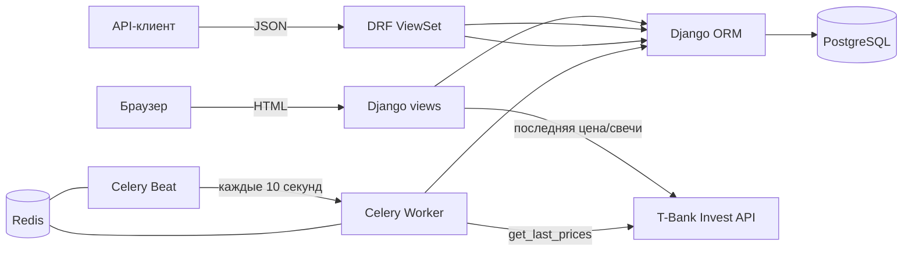

# Investing Demo: анализ, восстановленные требования и модернизация

Документ подготовлен по результатам анализа исходного кода репозитория
`aidd-topic-03-homework` (исходный коммит `362510b`, ветка `qwencode`).
Ссылки вида `dashboard/views.py:32` указывают на строки **исходной** версии;
ссылки на новую реализацию помечены отдельно.

---

## 1. Назначение приложения и технологический стек (задание 1.1)

### 1.1. Назначение

Investing Demo — учебное веб-приложение для просмотра российских и зарубежных
акций через T-Bank Invest API. Приложение:

- хранит каталог акций (FIGI, ISIN, тикер, название, валюта, UID);
- показывает текущую цену и признак роста/падения;
- строит график цены за последние 180 дней;
- периодически обновляет котировки в фоне через Celery;
- предоставляет REST API для CRUD-операций над акциями;
- имеет регистрацию и авторизацию пользователей по e-mail.

Управление каталогом в веб-интерфейсе доступно только авторизованным
пользователям; просмотр списка и карточки — анонимным.

### 1.2. Технологический стек

| Слой | Технология | Назначение |
|---|---|---|
| Язык | Python 3.x | Серверная логика |
| Web-фреймворк | Django 4.1.7 | ORM, шаблоны, auth, admin, management-команды |
| REST API | Django REST Framework 3.14 | ViewSet/Serializer для акций |
| Фильтрация API | django-filter 22.1 | Фильтры по name/ticker |
| Формы | django-crispy-forms 2.0 + crispy-bootstrap3 | Рендеринг форм |
| UI | Bootstrap 3/5-разметка, Django templates | Серверный HTML |
| Графики | Plotly 5.13.1 | Интерактивный график цены |
| Фоновая обработка | Celery 5.2.7 + Redis 4.5.1 | Периодическое обновление цен |
| БД | PostgreSQL (psycopg2-binary) | Хранение данных |
| Внешний API | T-Bank Invest API (`tinkoff-investments`) | Котировки, свечи, каталог |
| Запуск инфраструктуры | Docker Compose | PostgreSQL и Redis |

---

## 2. Структура проекта (задание 1.2)

```
.
├── config/                  # проект Django
│   ├── settings.py          # настройки, БД, Celery, логирование
│   ├── urls.py              # корневая маршрутизация
│   ├── celery.py            # Celery app и beat-schedule
│   └── wsgi.py / asgi.py
├── dashboard/               # основное приложение
│   ├── models.py            # модель Share
│   ├── views.py             # список/карточка/CRUD акций
│   ├── forms.py             # ModelForm акции
│   ├── urls.py              # HTML-маршруты и /api/
│   ├── tasks.py             # Celery-задача обновления цен
│   ├── services/
│   │   ├── market_data.py   # получение последней цены из T-Bank
│   │   └── graph.py         # построение графика 180 дней
│   ├── api/v1/              # DRF: router, serializer, views
│   ├── management/commands/add_shares.py
│   ├── migrations/          # 7 миграций модели Share
│   ├── templates/dashboard/ # base, list, detail, create, delete
│   └── static/dashboard/    # Bootstrap CSS
├── user/                    # регистрация/вход/выход
│   ├── forms.py             # AuthForm, RegistrationForm
│   ├── views.py             # AuthView, RegistrationView, LogoutView
│   └── templates/user/
├── docker-compose.yml       # postgres + redis
├── requirements.txt
└── manage.py
```

### 2.1. Назначение компонентов

| Компонент | Назначение |
|---|---|
| `dashboard.models.Share` | Единственная доменная сущность — акция и её последняя цена |
| `dashboard.views` | Серверные страницы: каталог, карточка, создание, изменение, удаление |
| `dashboard.services.market_data` | Изоляция вызова T-Bank для последней цены |
| `dashboard.services.graph` | Загрузка дневных свечей и рендер Plotly-графика |
| `dashboard.tasks` | Celery-задача обновления всех акций |
| `dashboard.api.v1` | REST CRUD `/api/v1/shares/` |
| `dashboard.management.commands.add_shares` | Первичное наполнение каталога из T-Bank |
| `user` | Аутентификация на базе стандартного `django.contrib.auth.User` |
| `config.celery` | Celery-приложение и расписание beat |

---

## 3. Архитектура и взаимодействие компонентов (задание 1.3)

### 3.1. Общая схема



### 3.2. Взаимодействие компонентов

1. **Веб-запрос списка.** `ShareListView` (`dashboard/views.py:20-26`) читает
   `Share.objects.all()` через ORM, сортирует по `name`, отдаёт первые 100
   записей в `dashboard/list.html`. Шаблон сам рисует пагинацию.
2. **Веб-запрос карточки.** `ShareDetailView.get` (`dashboard/views.py:29-38`)
   загружает акцию по `id`, синхронно вызывает `get_graph(share)`
   (`dashboard/services/graph.py:11-36`), который открывает T-Bank-клиент,
   запрашивает дневные свечи за 180 дней и формирует Plotly `<div>`.
3. **Управление каталогом.** `ShareCreateView`, `ShareUpdateView`,
   `ShareDeleteView` наследуют `IsUserAuthenticatedMixin`
   (`dashboard/views.py:11-17`): неавторизованный пользователь
   перенаправляется на список, а не на страницу входа.
4. **REST API.** `ShareViewSet` (`dashboard/api/v1/views.py:16-22`) —
   `ModelViewSet` без ограничений доступа; `ShareSerializer` отдаёт поля
   модели, кроме `uid`; пагинация — `LimitOffsetPagination`, 100 записей.
5. **Фоновое обновление.** `config/celery.py:13-18` регистрирует задачу
   `dashboard.tasks.update_last_price` с интервалом 10 секунд (несмотря на
   имя `add-every-5-min`). Задача (`dashboard/tasks.py:7-28`) перебирает все
   акции, получает последнюю цену через `get_last_data`
   (`dashboard/services/market_data.py:6-11`), сравнивает с сохранённой и
   делает `QuerySet.update()`.
6. **Наполнение каталога.** `add_shares` (`dashboard/management/commands/
   add_shares.py:11-22`) вызывает `client.instruments.shares()` и пытается
   создать записи через `get_or_create`.
7. **Аутентификация.** `AuthView`/`RegistrationView` (`user/views.py:8-55`)
   используют стандартные `authenticate`/`login`; пользователь хранится в
   `django.contrib.auth.User`, `username` равен e-mail.

### 3.3. Обработка пользовательских запросов

| URL исходной версии | View | Назначение | Доступ |
|---|---|---|---|
| `/` | `ShareListView` | Каталог акций | Анонимно |
| `/<int:pk>` | `ShareDetailView` | Карточка + график | Анонимно |
| `/create` | `ShareCreateView` | Добавление акции | Авторизованные |
| `/update/<int:pk>` | `ShareUpdateView` | Редактирование | Авторизованные |
| `/delete/<int:pk>` | `ShareDeleteView` | Удаление | Авторизованные |
| `/api/v1/shares/` | `ShareViewSet` | REST CRUD | Без ограничений |
| `/userlogin/` | `AuthView` | Вход | Анонимно |
| `/userregistration/` | `RegistrationView` | Регистрация | Анонимно |
| `/userlogout/` | `LogoutView` | Выход | Анонимно |

> Префикс `user` в `config/urls.py:7` задан без косой черты, поэтому
> фактически получились URL `/userlogin/`, `/userregistration/`,
> `/userlogout/`. В новой версии используются `/user/login/` и т. д., а
> старые адреса сохранены как 301-редиректы.

### 3.4. Работа с базой данных

- ORM Django, модели объявлены в `dashboard/models.py`.
- Миграции `0001`–`0007` последовательно добавляют уникальность `figi` и
  `ticker`, поле `uid`, `last_price`, `is_trend_high`, `updated_at` и
  уточняют `verbose_name`.
- Внешних ключей в исходной модели нет: акции не связаны с пользователями.
- Транзакции явно не используются; фоновая задача обновляет записи
  по одной.

---

## 4. Библиотеки и внешние зависимости (задание 1.4)

Исходный `requirements.txt` (40 строк) содержит как прямые зависимости, так и
транзитивные/инструментальные пакеты.

| Пакет | Версия | Роль | Состояние |
|---|---|---|---|
| Django | 4.1.7 | Web-фреймворк | EOL, несовместим с Python 3.13 |
| djangorestframework | 3.14.0 | REST API | Устарел |
| django-filter | 22.1 | Фильтры | Устарел |
| django-crispy-forms | 2.0 | Формы | Устарел |
| crispy-bootstrap3 | 2022.1 | Bootstrap 3 | Не соответствует Bootstrap 5 в шаблонах |
| celery | 5.2.7 | Очередь задач | Устарел |
| redis | 4.5.1 | Брокер | Устарел |
| psycopg2-binary | 2.9.5 | Драйвер PostgreSQL | Сборка/совместимость с Python 3.13 проблематична |
| plotly | 5.13.1 | Графики | Устарел |
| tinkoff-investments | 0.2.0b50 | Официальный SDK T-Bank | Beta-версия |
| tinkoff | 0.1.1 | Посторонний пакет с тем же namespace | Конфликтует с SDK, не нужен |
| grpcio | 1.51.3 | Транзитивная зависимость SDK | **Не собирается на Python 3.13** (проверено: `ModuleNotFoundError: No module named 'pkg_resources'` при сборке) |
| protobuf | 3.20.3 | Транзитивная | Устарел |
| pydantic | 1.10.6 | Транзитивная | Устарел |
| black / isort | 23.1.0 / 5.12.0 | Инструменты разработки | Не должны быть в runtime-зависимостях |

Дополнительно: `async-timeout`, `pytz`, `six`, `tomli`, `typing_extensions` и
др. — транзитивные зависимости, зафиксированные вручную. Версии не
разделены на runtime/dev, что затрудняет воспроизводимую установку.

Внешняя зависимость — T-Bank Invest API. Токен задаётся в
`config/settings.py` (`TINKOFF_TOKEN = ""`), то есть без переменных окружения
и без возможности безопасно передать секрет.

---

## 5. Модель данных (задание 1.5)

### 5.1. Сущность `Share` (акция)

| Поле | Тип | Ограничения | Назначение |
|---|---|---|---|
| `id` | BigAutoField | PK | Идентификатор |
| `figi` | CharField(255) | unique, not null | FIGI инструмента |
| `isin` | CharField(255) | not null | ISIN |
| `name` | CharField(255) | not null | Название компании |
| `ticker` | CharField(10) | unique, not null | Тикер |
| `currency` | CharField(20) | not null | Валюта |
| `uid` | CharField(255) | unique, not null | UID инструмента |
| `last_price` | FloatField | null | Последняя цена |
| `is_trend_high` | BooleanField | null | Признак «цена растёт» |
| `updated_at` | DateTimeField | auto_now, null | Время обновления записи |

`Meta`: `verbose_name = "Акция"`, `verbose_name_plural = "Акции"`.

### 5.2. Пользователь

Используется стандартная модель `django.contrib.auth.User`
(`user/models.py:1-3` — только алиас `User = get_user_model()`).
Дополнительных полей нет. Регистрация создаёт пользователя с
`username = email` (`user/forms.py:48-53`).

### 5.3. Связи

В исходной версии связей между сущностями нет: `Share` не привязана к
пользователю, отсутствуют списки наблюдения, портфели и история цен.
Единственная связь — неявная связь `User` с сессиями/правами Django.

### 5.4. Ограничения целостности

- `figi`, `ticker`, `uid` уникальны на уровне БД.
- Остальные поля обязательны, кроме `last_price`, `is_trend_high`,
  `updated_at`.
- Проверок положительности цены, формата тикера, валюты нет.

---

## 6. Механизмы обработки запросов и взаимодействия с БД (задание 1.6)

1. **HTTP → view.** Django URLconf (`config/urls.py`, `dashboard/urls.py`,
   `user/urls.py`) сопоставляет путь и вызывает class-based view.
2. **Web-формы.** `ShareModelForm` с `fields = "__all__"`
   (`dashboard/forms.py:6-11`) включает в форму и служебные поля
   (`last_price`, `is_trend_high`, `updated_at`), что позволяет перезаписать
   рассчитанные значения вручную.
3. **ORM.** Список — `Share.objects.all()`; карточка — `Share.objects.get(id=pk)`;
   обновление цены — `Share.objects.filter(id=...).update(...)`.
4. **REST.** DRF `ModelViewSet` автоматически реализует list/retrieve/create/
   update/partial_update/destroy; сериализатор (`dashboard/api/v1/serializer.py`)
   отдаёт `id, figi, isin, name, ticker, currency, last_price, is_trend_high,
   updated_at`, **не включая `uid`**, хотя `uid` обязателен в модели.
5. **Фоновая задача.** Celery worker получает задачу из Redis и выполняет
   синхронные HTTP/gRPC-вызовы T-Bank; beat планирует запуск каждые 10 секунд.
6. **График.** При каждом открытии карточки выполняется синхронный запрос
   свечей к T-Bank и рендеринг Plotly в HTML.
7. **Логирование.** Логгер `main` пишет в консоль и файл `app.logs`
   (`config/settings.py:37-59`).

---

## 7. Восстановленные функциональные требования (задание 2)

Требования описывают **фактически реализованное** поведение исходной версии.
Дефекты вынесены отдельно в раздел 7.4 и требованиями не являются.

### 7.1. Основные функциональные требования

| ID | Требование | Подтверждение в исходном коде |
|---|---|---|
| **FR-01** | Система отображает публичный список акций, отсортированный по названию, с постраничной выдачей по 100 записей. | `dashboard/views.py:20-26` (`ShareListView`, `paginate_by=100`, `ordering=["name"]`) |
| **FR-02** | В списке для каждой акции отображаются тикер, название, ISIN и текущая цена с валютой. Цвет ячейки цены зависит от `is_trend_high`. | `dashboard/templates/dashboard/list.html` (таблица, `mediumseagreen`/`palevioletred`) |
| **FR-03** | Пользователь может открыть карточку акции по её идентификатору; карточка показывает название, текущую цену, валюту и время обновления. | `dashboard/views.py:29-38`, `dashboard/templates/dashboard/detail.html` |
| **FR-04** | Карточка акции содержит интерактивный график дневных цен закрытия за последние 180 дней. | `dashboard/services/graph.py:11-36`, `detail.html` (`plot_div`) |
| **FR-05** | Добавление акции доступно только авторизованному пользователю. | `dashboard/views.py:41-46`, `IsUserAuthenticatedMixin` (`:11-17`) |
| **FR-06** | Редактирование акции доступно только авторизованному пользователю. | `dashboard/views.py:49-55` |
| **FR-07** | Удаление акции доступно только авторизованному пользователю и требует подтверждения. | `dashboard/views.py:58-63`, `delete.html` |
| **FR-08** | Форма добавления/редактирования содержит все поля модели, включая технические `figi`, `uid`, `last_price`, `is_trend_high`. | `dashboard/forms.py:6-11` (`fields="__all__"`) |
| **FR-09** | Неавторизованный пользователь при попытке открыть форму управления перенаправляется на список акций. | `dashboard/views.py:15-17` (`handle_no_permission`) |
| **FR-10** | Система периодически обновляет цены всех сохранённых акций в фоне. | `config/celery.py:13-18`, `dashboard/tasks.py:7-28` |
| **FR-11** | При обновлении цены система сохраняет новую цену и вычисляет признак роста: `is_trend_high = True`, если новая цена не меньше предыдущей, иначе `False`. | `dashboard/tasks.py:15-22` |
| **FR-12** | Команда `add_shares` импортирует каталог акций из T-Bank Invest API. | `dashboard/management/commands/add_shares.py:11-22` |
| **FR-13** | REST API предоставляет CRUD-операции над акциями по `/api/v1/shares/` с пагинацией 100 записей. | `dashboard/api/v1/views.py:16-22`, `config/settings.py:31-35` |
| **FR-14** | API поддерживает фильтрацию по `name` и `ticker`, поиск по началу `name`, сортировку по `name` и `ticker`. | `dashboard/api/v1/views.py:10-22` (`ShareFilter`, `OrderingFilter`, `SearchFilter`, `search_fields=["$name"]`) |
| **FR-15** | API возвращает поля `id, figi, isin, name, ticker, currency, last_price, is_trend_high, updated_at`. | `dashboard/api/v1/serializer.py:6-18` |
| **FR-16** | Пользователь может зарегистрироваться по e-mail и паролю с подтверждением пароля; после регистрации выполняется автоматический вход. | `user/forms.py:8-53`, `user/views.py:36-49` |
| **FR-17** | При регистрации проверяется совпадение паролей и отсутствие пользователя с таким e-mail. | `user/forms.py:30-46` |
| **FR-18** | Пользователь может войти по e-mail и паролю; при ошибке отображается сообщение «Неверный логин или пароль». | `user/views.py:15-33` |
| **FR-19** | Пользователь может выйти из системы; после выхода открывается список акций. | `user/views.py:58-63` |
| **FR-20** | Администратор может управлять акциями через Django Admin. | `dashboard/admin.py` |
| **FR-21** | Система ведёт журнал операций в консоль и файл `app.logs`. | `config/settings.py:37-59` |
| **FR-22** | Данные хранятся в PostgreSQL; Redis используется как брокер Celery. | `config/settings.py:91-104`, `docker-compose.yml` |

### 7.2. Основные сценарии взаимодействия

| ID | Сценарий | Шаги |
|---|---|---|
| **UC-01** | Просмотр каталога | Аноним открывает `/` → видит таблицу акций и пагинацию |
| **UC-02** | Просмотр карточки и графика | Аноним открывает `/<id>` → видит цену, время обновления, график 180 дней |
| **UC-03** | Регистрация | Открывает `/userregistration/` → вводит e-mail и два пароля → автоматически входит |
| **UC-04** | Вход/выход | Вводит e-mail/пароль → попадает в каталог; выход возвращает в каталог |
| **UC-05** | Добавление акции | Авторизованный пользователь нажимает «Добавить» → заполняет все поля → запись появляется в списке |
| **UC-06** | Редактирование/удаление | Авторизованный пользователь меняет поля или подтверждает удаление |
| **UC-07** | Фоновое обновление цен | Celery Beat запускает задачу каждые 10 секунд → worker обновляет `last_price`/`is_trend_high` |
| **UC-08** | Работа через API | API-клиент выполняет GET/POST/PUT/DELETE `/api/v1/shares/` |
| **UC-09** | Импорт каталога | Оператор запускает `python manage.py add_shares` |

### 7.3. Бизнес-правила и ограничения

| ID | Правило | Подтверждение |
|---|---|---|
| **BR-01** | `figi`, `ticker`, `uid` уникальны; попытка создать дубликат отклоняется БД. | `dashboard/models.py:7,10,12`; миграции `0002`, `0003` |
| **BR-02** | Тикер ограничен 10 символами. | `dashboard/models.py:10` |
| **BR-03** | Цена считается растущей, если новая цена `>=` предыдущей; при первом обновлении (предыдущая цена `None`) признак становится `True`. | `dashboard/tasks.py:15-22` (исключение в `try` трактуется как рост) |
| **BR-04** | Список сортируется по названию, размер страницы — 100. | `dashboard/views.py:25-26` |
| **BR-05** | E-mail пользователя уникален на уровне приложения (проверка в форме), `username = email`. | `user/forms.py:39-53` |
| **BR-06** | Пароли при регистрации должны совпадать; иных требований к сложности нет. | `user/forms.py:35-37` |
| **BR-07** | API отдаёт не более 100 записей на страницу. | `config/settings.py:31-35` |
| **BR-08** | API-поиск по имени выполняется по префиксу (DRF `$name`). | `dashboard/api/v1/views.py:22` |

### 7.4. Неоднозначности, противоречия и дефекты реализации

Эти пункты **не являются требованиями**: это расхождения между задуманным и
реализованным поведением, а также технические дефекты.

| ID | Проблема | Подтверждение | Последствие |
|---|---|---|---|
| **DEF-01** | Пустой `SECRET_KEY` и `ALLOWED_HOSTS=[]`. | `config/settings.py:6,10` | Приложение не запускается/не работает с сессиями и формами |
| **DEF-02** | Зависимости несовместимы с современным Python. | `requirements.txt:13,17,27` | Установка падает на сборке `grpcio==1.51.3` (Python 3.13); Django 4.1 EOL |
| **DEF-03** | Токен T-Bank пуст и хранится в коде; нет обработки отсутствия токена. | `config/settings.py:134`, `market_data.py:7`, `graph.py:12` | Любой запрос цены/графика падает |
| **DEF-04** | Цена берётся только из `price.units`/`close.units`, дробная часть (`nano`) теряется. | `market_data.py:11`, `graph.py:20` | Цена 100.50 отображается как 100 |
| **DEF-05** | Карточка использует `Share.objects.get(id=pk)` без обработки `DoesNotExist`. | `dashboard/views.py:32` | Несуществующий id → HTTP 500 вместо 404 |
| **DEF-06** | Ошибки T-Bank при построении графика не обрабатываются. | `dashboard/views.py:37`, `graph.py:12-20` | Падение карточки при недоступном API |
| **DEF-07** | В графике `Scatter` получает `marker_color` вместо `line.color`, серия называется `test`. | `graph.py:27-29` | Некорректная настройка линии, тестовое имя в легенде |
| **DEF-08** | Задача обновляет запись через `QuerySet.update()`, не затрагивая `auto_now`. | `dashboard/tasks.py:24-26` | `updated_at` не обновляется, карточка показывает старое время |
| **DEF-09** | При первом обновлении цена `None`, возникает исключение, и `is_trend_high` принудительно ставится `True`. | `dashboard/tasks.py:15-22` | Ложный «рост» без предыдущей цены; логика построена на исключении |
| **DEF-10** | Задача называется `add-every-5-min`, но интервал — 10 секунд. | `config/celery.py:14-16` | Несоответствие документации и нагрузки |
| **DEF-11** | `get_or_create` ищет по всем полям, включая изменяемые `name`, `isin` и др. | `add_shares.py:15-21` | При изменении названия компании возникает `IntegrityError` по `figi` |
| **DEF-12** | `AuthView.post` обращается к `form.data["email"]` без валидации. | `user/views.py:17-20` | POST без поля e-mail → `KeyError`/500 |
| **DEF-13** | `RegistrationView` читает `form.errors["__all__"]` для любой ошибки. | `user/views.py:54` | Ошибка валидации поля (например, e-mail) → `KeyError`/500 |
| **DEF-14** | Пароли создаются через `create_user` без `validate_password`. | `user/forms.py:48-53` | Валидаторы из `settings` не применяются |
| **DEF-15** | E-mail при регистрации не нормализуется, проверка дубликата регистрозависима; вход приводит e-mail к нижнему регистру. | `user/forms.py:39,51`, `user/views.py:19` | Регистрация `User@…` и вход `user@…` несовместимы; возможны дубликаты по регистру |
| **DEF-16** | API `ModelViewSet` не имеет permissions. | `dashboard/api/v1/views.py:16-22` | Аноним может создавать/изменять/удалять акции |
| **DEF-17** | Сериализатор не содержит `uid`, хотя поле обязательно и уникально. | `dashboard/api/v1/serializer.py:6-18`, `models.py:12` | Создание через API приводит к ошибке целостности |
| **DEF-18** | `docker-compose.yml` монтирует каталог проекта в `/app` контейнера PostgreSQL; нет тома для данных. | `docker-compose.yml:13-14` | Данные БД не сохраняются, том конфликтует с образом |
| **DEF-19** | В шаблонах одновременно подключён Plotly CDN и встроенный Plotly из `plot()`. | `dashboard/templates/dashboard/base.html`, `graph.py:21-35` | Дублирование JS, лишний объём страницы |
| **DEF-20** | `col3` — несуществующий класс Bootstrap; контент карточки смещён. | `dashboard/templates/dashboard/detail.html` | Нарушение вёрстки |
| **DEF-21** | Тесты API не покрывают авторизацию и не проверяют создание с обязательным `uid`; тесты не запускаются на исходных зависимостях. | `dashboard/tests.py` | Дефекты DEF-16/DEF-17 не обнаруживаются |
| **DEF-22** | Префикс `user` без `/` даёт URL `/userlogin/` вместо ожидаемого `/user/login/`. | `config/urls.py:7` | Неочевидная маршрутизация |
| **DEF-23** | `last_price` — `FloatField`, денежные значения хранятся с плавающей точкой. | `dashboard/models.py:13` | Ошибки округления денежных значений |
| **DEF-24** | Форма акции позволяет вручную задать `last_price`/`is_trend_high`, перезаписывая расчётные значения. | `dashboard/forms.py:6-11` | Данные теряют достоверность |

---

## 8. Модернизация, устранение дефектов и рефакторинг (задание 3)

### 8.1. Обновление зависимостей

| Компонент | Было | Стало | Причина |
|---|---|---|---|
| Python | не зафиксирован | 3.13 (проверено) | Актуальная среда |
| Django | 4.1.7 | **5.2.18 LTS** | Поддержка, безопасность, Python 3.13 |
| DRF | 3.14.0 | **3.18.3** | Совместимость с Django 5.2 |
| django-filter | 22.1 | **26.2** | Совместимость |
| crispy-forms | 2.0 | **2.7** | Совместимость |
| crispy-bootstrap3 | 2022.1 | **crispy-bootstrap5 2026.9** | Шаблоны используют Bootstrap 5.1.3 |
| Celery | 5.2.7 | **5.6.3** | Поддержка, Python 3.13 |
| Redis | 4.5.1 | **8.1.0** | Совместимость с Celery 5.6 |
| PostgreSQL driver | psycopg2-binary 2.9.5 | **psycopg[binary] 3.3.6** | Psycopg 3, Python 3.13 |
| Plotly | 5.13.1 | **7.1.0** (plotly.js 4.1.1) | Актуальная версия |
| T-Bank SDK | `tinkoff-investments==0.2.0b50` + посторонний `tinkoff==0.1.1` | **`requirements-market.txt`: `tinkoff-investments>=0.2.0b59`** (invest-python) | Официальный поддерживаемый SDK; опционален |
| Dev-инструменты | black/isort в runtime | **requirements-dev.txt** | Разделение runtime/dev |

Проверка: `pip check` — «No broken requirements found»; `manage.py check` —
0 ошибок.

### 8.2. Конфигурация и запуск

- Все секреты и режимы вынесены в переменные окружения (`.env`,
  `python-dotenv`): `DJANGO_SECRET_KEY`, `DJANGO_DEBUG`,
  `DJANGO_ALLOWED_HOSTS`, `DATABASE_ENGINE`, `TINKOFF_INVEST_TOKEN`,
  `MARKET_DATA_PROVIDER`, `CELERY_BROKER_URL`, `ALERTS_EMAIL_ENABLED` и др.
  Пример — `.env.example`.
- **SQLite по умолчанию** — приложение запускается без Docker/PostgreSQL;
  PostgreSQL включается `DATABASE_ENGINE=postgres`.
- `SECRET_KEY` обязателен при `DEBUG=false`; в dev допускается небезопасный
  ключ с предупреждением.
- `ALLOWED_HOSTS` по умолчанию включает `localhost`, `127.0.0.1`,
  `testserver`; добавлены `CSRF_TRUSTED_ORIGINS` и опциональный
  `DJANGO_SECURE_SSL` (HTTPS-cookies, HSTS).
- `docker-compose.yml` исправлен: PostgreSQL 16 с healthcheck и именованным
  томом `postgres_data`, Redis 7; проект больше не монтируется в контейнер БД.
- Логирование сохранено (консоль + `app.logs`), путь сделан абсолютным.
- Локализация: `ru-ru`, `Europe/Moscow` для Celery, `UTC` для БД.

### 8.3. Исправленные дефекты

| Дефект | Решение | Проверка |
|---|---|---|
| DEF-01 | Env-настройки, dev-fallback ключа, `ALLOWED_HOSTS` | `manage.py check`, запуск сервера |
| DEF-02 | Обновлён стек, разделены runtime/dev, Python 3.13 | `pip install`, 101 тест |
| DEF-03 | Провайдер рыночных данных + синтетический режим без токена | `test_providers`, `seed_demo`, smoke |
| DEF-04 | `Decimal` + учёт `units + nano/1e9`; `last_price` → `DecimalField` | `test_nano_part_is_not_lost`, миграция `0008` |
| DEF-05 | `get_object_or_404` | `test_detail_missing_returns_404` |
| DEF-06 | `ensure_history` перехватывает ошибки провайдера; карточка показывает предупреждение | `test_ensure_history_*` |
| DEF-07 | График на `plotly.graph_objects.Figure`, корректный `line.color`, имя «Цена» | smoke карточки, HTML-тест `price-chart` |
| DEF-08 | `share.save(update_fields=[..., "updated_at"])` + явный `updated_at` | `test_refresh_updates_price_trend_and_snapshot` |
| DEF-09 | Явная семантика: первая цена → `True`, далее `new >= old` | `test_first_price_is_treated_as_growth`, `test_price_drop_sets_trend_false` |
| DEF-10 | Beat `refresh-market-data-every-minute`, 60 секунд, имя соответствует | `config/celery.py` |
| DEF-11 | `update_or_create(figi=..., defaults=...)` | `test_add_shares_is_idempotent_and_updates_existing` |
| DEF-12/13 | Формы валидируются, ошибки рендерятся; нет доступа к `data`/`errors["__all__"]` | `user/tests/test_auth.py` (6 тестов) |
| DEF-14 | `validate_password` в `RegistrationForm.clean` | `test_weak_password_rejected` |
| DEF-15 | Нормализация e-mail, регистронезависимая проверка | `test_successful_registration_normalizes_email`, `test_duplicate_email_is_case_insensitive` |
| DEF-16 | `IsAuthenticatedOrReadOnly` для акций; `IsAuthenticated` для новых API | `test_anonymous_cannot_write` |
| DEF-17 | `uid` добавлен в сериализатор, служебные поля read-only | `test_authenticated_crud`, `test_last_price_is_read_only` |
| DEF-18 | Исправлен compose (том, healthcheck, версии) | `docker compose config` (в среде без Docker не запускалось) |
| DEF-19/20 | Plotly подключается один раз; карточка переписана на Bootstrap 5 | smoke, HTML-тесты |
| DEF-21 | 101 автоматизированный тест, включая auth/API/цены | `manage.py test` / `pytest` |
| DEF-22 | Новые URL + 301-редиректы старых | `test_legacy_urls_redirect` |
| DEF-23 | `DecimalField(18,6)` для цен, денежные расчёты — `Decimal` | миграция, тесты цен |
| DEF-24 | Форма акции ограничена полями каталога; расчётные поля read-only в API/админке | `dashboard/forms.py`, `test_last_price_is_read_only` |

### 8.4. Рефакторинг

- Введён слой `market`:
  - `providers.py` — единый интерфейс `MarketDataProvider` с реализациями
    `TinkoffProvider` (официальный invest-python) и `SyntheticProvider`
    (детерминированные данные для demo/tests);
  - `services.py` — обновление цен, снимки, история, статистика;
  - `charts.py` — построение графиков;
  - `tasks.py` — Celery-задачи;
  - `models.py` — `PriceSnapshot`.
- Удалены дублирующие `dashboard/services/market_data.py` и `graph.py`;
  прямые импорты `tinkoff.invest` остались только в `market/providers.py`.
- Добавлены сервисные слои для портфелей (`portfolio/services.py`) и
  стратегий (`strategy/services.py`); бизнес-логика отделена от views/API.
- Устранено дублирование форм/шаблонов, унифицирован Bootstrap 5 и crispy.
- Фоновые операции доступны и без Redis через management-команды
  (`refresh_prices`, `sync_history`), что упрощает локальный запуск.
- Сохранена обратная совместимость URL и API.

### 8.5. Автоматизированные тесты и результаты проверки

```
python manage.py check                  # 0 issues
python manage.py test                   # Ran 101 test — OK
pytest -q                               # 101 passed
python manage.py migrate                # все миграции применяются
python manage.py seed_demo              # демо-данные создаются
python manage.py runserver              # сервер запускается
```

Покрыты: модели/сервисы цен, провайдеры и точность `Decimal`, история,
алерты и дедупликация, портфельные операции и P&L, стратегии, API-права,
аутентификация, management-команды, обратная совместимость URL.

### 8.6. Запуск после изменений

```bash
python3 -m venv .venv
. .venv/bin/activate
pip install -r requirements.txt          # runtime
pip install -r requirements-dev.txt      # тесты (опционально)
cp .env.example .env
python manage.py migrate
python manage.py seed_demo               # demo@example.com / demo12345
python manage.py runserver
```

Опционально для реальных котировок:

```bash
pip install -r requirements-market.txt
# .env: TINKOFF_INVEST_TOKEN=...; MARKET_DATA_PROVIDER=tbank
```

Без токена используется `SyntheticProvider` — приложение остаётся
работоспособным и воспроизводимым.

---

## 9. Новая функциональность (задание 4)

### 9.1. Функциональные требования к новой функциональности

#### Персональный мониторинг акций

| ID | Требование |
|---|---|
| **FR-N01** | Пользователь может создавать несколько именованных списков наблюдения; название уникально в рамках пользователя. |
| **FR-N02** | Пользователь может добавлять акции в список и удалять их; повторное добавление одной акции в список запрещено. |
| **FR-N03** | Для акции в списке можно задать несколько целевых уровней: «цена выше или равна» / «цена ниже или равна»; порог должен быть положительным. |
| **FR-N04** | Целевые уровни проверяются автоматически при каждом обновлении рыночной цены. |
| **FR-N05** | При достижении уровня создаётся ровно одно уведомление о событии; повторная обработка того же снимка цены не создаёт дубликат. |
| **FR-N06** | После срабатывания уровень выключается; повторно он взводится только при возврате цены за порог с запасом `PRICE_ALERT_REARM_MARGIN` (0.5%) или вручную. Уровень, выключенный вручную, автоматически не взводится. |
| **FR-N07** | Пользователь видит список уведомлений, может отметить одно или все как прочитанные. При включении `ALERTS_EMAIL_ENABLED` отправляется e-mail. |
| **FR-N08** | Все списки, уровни и уведомления изолированы по пользователю; чужой объект недоступен (404/400). |

#### Виртуальный инвестиционный портфель

| ID | Требование |
|---|---|
| **FR-N09** | Пользователь создаёт портфели с названием и начальным капиталом; свободные средства инициализируются начальным капиталом. |
| **FR-N10** | Пользователь моделирует покупку и продажу акций по цене (по рынку или явно). |
| **FR-N11** | Покупка проверяет достаточность средств; продажа — достаточность количества; при ошибке операция полностью откатывается. |
| **FR-N12** | Количество и средняя цена приобретения рассчитываются по средневзвешенному методу; продажа фиксирует реализованную прибыль/убыток. |
| **FR-N13** | Система рассчитывает рыночную стоимость позиций, свободные средства, стоимость портфеля, нереализованную/реализованную прибыль, общую прибыль и доходность. |
| **FR-N14** | Пользователь видит историю всех операций портфеля. |

#### История изменения рыночных цен

| ID | Требование |
|---|---|
| **FR-N15** | При каждом обновлении цены сохраняется снимок `(акция, цена, момент, источник)`; дубликат по моменту времени не создаётся. |
| **FR-N16** | История доступна за выбранный период (30/90/180/365 дней в UI, 1–3650 в API). |
| **FR-N17** | Для периода рассчитываются первая/последняя цена, абсолютное и процентное изменение, минимум/максимум, количество точек. |
| **FR-N18** | История отображается в виде интерактивного графика; при отсутствии данных выполняется догрузка дневных свечей из провайдера. |

#### Симулятор инвестиционных стратегий

| ID | Требование |
|---|---|
| **FR-N19** | Пользователь создаёт стратегию для выбранной акции с начальным капиталом и набором правил. |
| **FR-N20** | Правило задаёт операцию (покупка/продажа), условие (цена выше/ниже порога), порог и количество. |
| **FR-N21** | Активные правила проверяются при каждом обновлении цены; при выполнении условия моделируется виртуальная сделка с учётом доступных средств/акций. |
| **FR-N22** | Одна и та же пара (правило, снимок цены) не может создать две сделки; повторный запуск задачи идемпотентен. |
| **FR-N23** | Ведётся журнал сделок с ценой, количеством, реализованным P&L, остатком средств и позиции. |
| **FR-N24** | Эффективность стратегии оценивается: стоимость, прибыль, доходность, реализованная/нереализованная прибыль, число сделок. |
| **FR-N25** | Стратегию и правила можно включать/выключать; правило с историей сделок нельзя удалить (защита журнала). |
| **FR-N26** | Вся новая функциональность доступна через веб-интерфейс и REST API; данные изолированы по пользователю. |

### 9.2. Изменения архитектуры

Добавлены четыре доменных приложения:

```
market/       — провайдеры, снимки цен, история, графики, задачи
watchlist/    — списки наблюдения, целевые цены, уведомления
portfolio/    — портфели, позиции, операции, оценка
strategy/     — стратегии, правила, виртуальные сделки
```

Ключевые решения:

1. **Провайдер рыночных данных** — интерфейс `MarketDataProvider`.
   `TinkoffProvider` использует официальный SDK invest-python; при отсутствии
   токена/SDK `auto`-режим выбирает `SyntheticProvider`. Это позволяет
   запускать приложение и тесты без внешней сети, не меняя бизнес-логику.
2. **Единый конвейер обновления**:
   `Celery Beat → market.tasks.refresh_market_data → refresh_all →
   refresh_share → PriceSnapshot → process_share_alerts →
   process_share_strategies`.
   Ошибка по одной акции логируется и не прерывает обработку остальных.
3. **Идемпотентность**: уникальные ограничения
   `(share, captured_at)`, `(alert, price_snapshot)`,
   `(strategy, rule, price_snapshot)` плюс блокировки `select_for_update`.
4. **Сервисный слой**: views/API не содержат расчётов; портфель и стратегии
   работают в транзакциях.
5. **UI**: серверные страницы на Bootstrap 5 + crispy-bootstrap5; графики —
   Plotly; навигация по всем модулям.
6. **REST API**: пользовательские ViewSet'ы с `IsAuthenticated` и фильтрацией
   queryset по `request.user`.

### 9.3. Изменения модели данных

| Модель | Ключевые поля | Ограничения |
|---|---|---|
| `market.PriceSnapshot` | `share`, `price`, `captured_at`, `source` | unique `(share, captured_at)`, индекс `(share, -captured_at)` |
| `watchlist.Watchlist` | `user`, `name`, `created_at` | unique `(user, name)` |
| `watchlist.WatchlistItem` | `watchlist`, `share`, `note` | unique `(watchlist, share)` |
| `watchlist.PriceAlert` | `item`, `condition`, `target_price`, `is_active`, `triggered_at`, `triggered_price` | `target_price > 0` |
| `watchlist.Notification` | `user`, `alert`, `price_snapshot`, `price`, `message`, `is_read` | unique `(alert, price_snapshot)` |
| `portfolio.Portfolio` | `user`, `name`, `initial_cash`, `cash` | unique `(user, name)`, неотрицательные суммы |
| `portfolio.Position` | `portfolio`, `share`, `quantity`, `avg_price` | unique `(portfolio, share)`, `quantity > 0` |
| `portfolio.Transaction` | `portfolio`, `share`, `side`, `quantity`, `price`, `realized_pnl`, `executed_at` | положительные quantity/price, индекс по времени |
| `strategy.Strategy` | `user`, `name`, `share`, `initial_cash`, `cash`, `quantity`, `avg_price`, `realized_pnl`, `is_active` | unique `(user, name)`, неотрицательные значения |
| `strategy.StrategyRule` | `strategy`, `side`, `condition`, `threshold`, `quantity`, `is_active` | положительные threshold/quantity |
| `strategy.StrategyTrade` | `strategy`, `rule`, `price_snapshot`, `side`, `quantity`, `price`, `realized_pnl`, `cash_after`, `position_after` | unique `(strategy, rule, price_snapshot)` |

`Share.last_price` переведён с `FloatField` на `DecimalField(18,6)`.

### 9.4. REST API новой функциональности

Все пользовательские endpoints требуют аутентификации (кроме чтения акций и
публичной истории цен). Данные фильтруются по владельцу.

| Метод и путь | Назначение |
|---|---|
| `GET/POST /api/v1/watchlists/` | Списки наблюдения (с вложенными акциями и уровнями) |
| `GET/POST /api/v1/watchlist-items/` | Акции в списках |
| `GET/POST /api/v1/price-alerts/` | Целевые уровни; `POST /{id}/rearm/` — ручное взведение |
| `GET /api/v1/notifications/` | Уведомления; `POST /{id}/read/` — отметить прочитанным |
| `GET/POST /api/v1/portfolios/` | Портфели |
| `GET/POST /api/v1/portfolios/{id}/trades/` | История/выполнение операции |
| `GET /api/v1/portfolios/{id}/valuation/` | Оценка портфеля и P&L |
| `GET /api/v1/positions/`, `/api/v1/transactions/` | Позиции и операции (read-only) |
| `GET/POST /api/v1/strategies/` | Стратегии |
| `POST /api/v1/strategies/{id}/run/` | Ручная проверка правил |
| `GET /api/v1/strategies/{id}/metrics/` | Эффективность стратегии |
| `GET/POST /api/v1/strategy-rules/` | Правила |
| `GET /api/v1/strategy-trades/` | Журнал сделок |
| `GET /api/v1/price-history/?share=&days=` | История цен и статистика |

### 9.5. Пользовательский интерфейс

| Страница | URL | Возможности |
|---|---|---|
| Каталог | `/` | Список, цены, переход к истории |
| Карточка | `/shares/<id>/?days=30/90/180/365` | Цена, статистика, график, последние снимки |
| Наблюдение | `/watchlists/`, `/watchlists/<id>/` | Создание списков, добавление акций, уровни, включение/выключение |
| Уведомления | `/notifications/` | Список, отметка прочитанным |
| Портфели | `/portfolios/`, `/portfolios/<id>/` | Создание, покупка/продажа, позиции, P&L, история |
| Стратегии | `/strategies/`, `/strategies/<id>/` | Создание, правила, запуск, журнал, метрики, вкл/выкл |

### 9.6. Дедупликация уведомлений и сделок

- **Уведомления.** `trigger_alert` выполняется в транзакции с
  `select_for_update` по алерту. Запись создаётся через `get_or_create` по
  `(alert, price_snapshot)`; уникальное ограничение БД защищает от гонок.
  После срабатывания `is_active=False`, `triggered_at` заполняется.
  Автоматическое повторное взведение выполняется только для алертов с
  заполненным `triggered_at` и лишь после возврата цены за порог с запасом.
- **Сделки.** `evaluate_strategy` блокирует стратегию, проверяет наличие
  `StrategyTrade` для `(rule, snapshot)` и опирается на уникальное
  ограничение. Повторный запуск на том же снимке не создаёт сделку.
- **Снимки цен.** `(share, captured_at)` уникальны; `get_or_create` /
  `bulk_create(ignore_conflicts=True)` устраняют дубликаты при повторных
  запросах.

### 9.7. Проверка новой функциональности

| Блок | Тесты |
|---|---|
| Провайдеры и точность цен | `market/tests/test_providers.py` |
| Обновление цен, история, статистика | `market/tests/test_services.py` |
| Алерты, дедупликация, rearm, e-mail | `watchlist/tests/test_services.py` |
| Watchlist UI/API, изоляция | `watchlist/tests/test_views.py`, `test_api.py` |
| Портфель: buy/sell, средняя цена, P&L, API | `portfolio/tests/test_services.py`, `test_api.py` |
| Стратегии: правила, идемпотентность, метрики, API | `strategy/tests/test_services.py`, `test_api.py` |
| История цен API | `dashboard/tests/test_api.py` |
| Демо-данные и импорт | `dashboard/tests/test_commands.py` |

Итог: **101 тест, все проходят** (`python manage.py test` и `pytest -q`).

---

## 10. Сохранение исходной функциональности

| Исходное требование | Статус | Подтверждение |
|---|---|---|
| FR-01/02 Список и пагинация | Сохранено | `test_list_is_public`, шаблон `list.html` |
| FR-03/04 Карточка и график 180 дней | Сохранено, график из БД | `test_detail_renders_chart` |
| FR-05…FR-09 Управление авторизованным пользователем | Сохранено | `test_create_requires_login`, `test_authenticated_crud` |
| FR-10/11 Фоновое обновление и trend | Сохранено | тесты `market` |
| FR-12 Импорт каталога | Сохранено и исправлено | `test_add_shares_*` |
| FR-13…FR-15 REST API | Сохранено, добавлен `uid`, закрыта запись | `test_api.py` |
| FR-16…FR-19 Регистрация/вход/выход | Сохранено | `user/tests/test_auth.py` |
| FR-20 Admin | Сохранено | `manage.py check` |
| FR-21 Логирование | Сохранено | `settings.py` |
| FR-22 PostgreSQL/Redis | Сохранено, SQLite для dev | `docker-compose.yml`, настройки |
| Старые URL | Сохранены 301-редиректами | `test_legacy_urls_redirect` |

---

## 11. Ограничения и допущения

1. **Нет реального токена T-Bank.** В среде выполнения отсутствуют токен,
   Docker, PostgreSQL и Redis, а SDK `tinkoff-investments` недоступен из
   используемого индекса пакетов. Поэтому основной проверенный режим —
   `SyntheticProvider`; `TinkoffProvider` реализован по официальному API
   invest-python, но не проверен на живом API.
2. **Синтетические данные** детерминированы и предназначены для demo/tests;
   они не являются рыночными котировками.
3. **SQLite по умолчанию.** PostgreSQL-конфигурация и compose добавлены, но
   не запускались в этой среде (Docker отсутствует).
4. **Уведомления** по умолчанию внутриприложенческие; e-mail включается
   настройкой и использует console/locmem backend в dev.
5. **Стратегии** моделируются на поступающих снимках цен (live-симуляция) и
   по кнопке «Проверить сейчас»; исторический backtest за прошлые периоды не
   реализован.
6. **Визуальная проверка** ограничена HTTP-smoke и HTML-тестами; скриншоты
   браузера не снимались.
7. **Оценка портфеля** использует последнюю сохранённую цену; при отсутствии
   обновлений она может быть устаревшей (это ожидаемое поведение demo).
8. **E-mail пользователя** уникален на уровне формы, а не БД (стандартная
   модель Django `User`); гонка двух одновременных регистраций теоретически
   возможна.

---

## Приложение A. Основные команды

```bash
# инфраструктура (опционально)
docker compose up -d db redis

# миграции и демо
python manage.py migrate
python manage.py seed_demo
python manage.py add_shares
python manage.py sync_history --days 180

# обновление цен и проверка правил без Celery
python manage.py refresh_prices

# фоновый режим
celery -A config worker -l info
celery -A config beat

# тесты
python manage.py test
pytest -q
```
