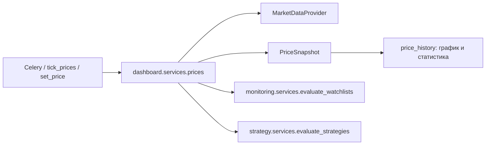
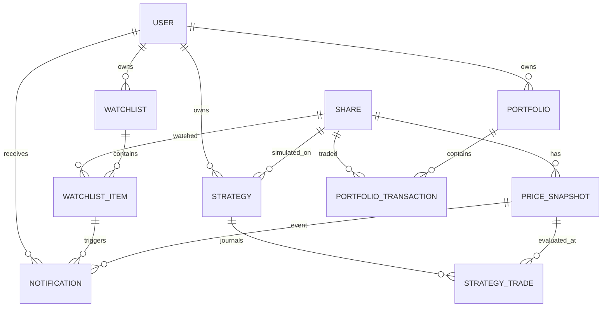

# Задание №4. Новая функциональность

В исходной версии приложения были только справочник акций, текущая цена,
график из Tinkoff, аутентификация и API акций. В рамках задания реализованы
четыре новых домена:

1. персональный мониторинг акций;
2. виртуальный инвестиционный портфель;
3. история изменения рыночных цен;
4. симулятор инвестиционных стратегий.

Функциональность отделена от исправлений задания №3 структурно: новые
приложения `monitoring`, `portfolio`, `strategy` и модель `PriceSnapshot`
выделены в отдельные модули, а исправления и новые требования описаны в разных
документах (`MODERNIZATION.md` и этом файле).

## 1. Функциональные требования

### 1.1. Общие требования

- **FR-COMMON-01.** Все персональные данные (списки, уведомления, портфели,
  стратегии) принадлежат пользователю; другой пользователь не может читать или
  изменять их ни через HTML, ни через API.
- **FR-COMMON-02.** Для доступа к персональным разделам требуется
  аутентификация; анонимный запрос перенаправляется на страницу входа (HTML) или
  получает 401/403 (API).
- **FR-COMMON-03.** Функциональность работает без токена T-Invest благодаря
  симулированному провайдеру; при наличии токена используется живой провайдер.
- **FR-COMMON-04.** Все операции с деньгами и количествами выполняются в
  `Decimal`, без бинарных float-ошибок.

### 1.2. Списки наблюдения и уведомления

- **FR-WATCH-01.** Пользователь может создать несколько именованных списков
  наблюдения, переименовать и удалить их. Имена уникальны в рамках пользователя.
- **FR-WATCH-02.** В список можно добавить акцию, указав целевое значение цены и
  направление условия: «цена выше или равна» либо «цена ниже или равна».
  Одна акция может входить в список только один раз.
- **FR-WATCH-03.** При каждом новом снимке цены система проверяет активные
  элементы списков и создаёт уведомление при переходе условия из «не выполнено»
  в «выполнено».
- **FR-WATCH-04.** Пока условие остаётся выполненным, повторные снимки не
  создают новые уведомления об одном и том же событии. После сброса условия
  (цена вернулась за уровень) элемент снова готов к срабатыванию.
- **FR-WATCH-05.** Пользователь видит список уведомлений, может отметить одно
  уведомление или все уведомления прочитанными, отфильтровать непрочитанные.
- **FR-WATCH-06.** Дополнительно может отправляться e-mail через настроенный
  `EMAIL_BACKEND`; по умолчанию используется консольный backend и флаг
  `WATCHLIST_EMAIL_NOTIFICATIONS=false`.
- **FR-WATCH-07.** Выключенный элемент (`is_active=False`) не создаёт
  уведомлений.

### 1.3. Виртуальный инвестиционный портфель

- **FR-PORT-01.** Пользователь может создать несколько портфелей с названием и
  базовой валютой; имена уникальны в рамках пользователя.
- **FR-PORT-02.** В портфель можно добавить операцию покупки или продажи акции:
  количество, цена, комиссия, дата/время, комментарий.
- **FR-PORT-03.** Количество и цена должны быть положительными; комиссия не
  может быть отрицательной.
- **FR-PORT-04.** Продажа не может превышать количество акций, имеющееся на
  момент операции. Проверка выполняется с учётом хронологии операций.
- **FR-PORT-05.** Средняя цена приобретения рассчитывается по методу средней
  стоимости с включением комиссии покупки:
  `avg = (old_avg * old_qty + price * qty + commission) / (old_qty + qty)`.
- **FR-PORT-06.** При продаже реализованный P&L рассчитывается как
  `(sell_price - avg) * qty - commission`; средняя цена остатка не меняется.
- **FR-PORT-07.** Текущая стоимость позиции — `quantity * last_price`; если
  рыночная цена отсутствует, используется средняя цена (нереализованный P&L = 0).
- **FR-PORT-08.** Портфель показывает позиции, количество, среднюю цену,
  текущую цену, стоимость, реализованный и нереализованный P&L, итоговую
  стоимость и общий P&L.
- **FR-PORT-09.** Пользователь видит полную историю операций, может добавлять,
  редактировать и удалять операции; после изменения история и P&L
  пересчитываются.

### 1.4. История рыночных цен

- **FR-HIST-01.** Каждое успешное обновление цены сохраняет снимок
  `PriceSnapshot`: акция, цена, время, источник (`live`, `history`,
  `simulated`).
- **FR-HIST-02.** Снимки уникальны по паре «акция + время»; повторная обработка
  того же снимка не создаёт дубликат.
- **FR-HIST-03.** При недостатке данных история автоматически загружается из
  провайдера (дневные свечи) и сохраняется в БД.
- **FR-HIST-04.** Команда `sync_price_history` позволяет принудительно
  загрузить историю за указанный период для выбранных тикеров.
- **FR-HIST-05.** На странице акции доступны периоды 7, 30, 90, 180, 365 дней;
  отображаются график, первая/последняя цена, абсолютное и процентное изменение,
  минимум, максимум, среднее и количество точек.
- **FR-HIST-06.** API `GET /api/v1/shares/<id>/history/?days=30` возвращает
  точки истории и статистику; недопустимый период заменяется на 180 дней.
- **FR-HIST-07.** История сохраняется между перезапусками приложения.

### 1.5. Симулятор инвестиционных стратегий

- **FR-STRAT-01.** Пользователь может создать несколько стратегий; имя
  уникально в рамках пользователя. Стратегия привязана к акции и содержит порог
  покупки, порог продажи, начальный капитал, необязательный фиксированный размер
  сделки и признак активности.
- **FR-STRAT-02.** Порог продажи должен быть строго выше порога покупки;
  начальный капитал положителен.
- **FR-STRAT-03.** При новом снимке цены активная стратегия покупает, если
  позиция отсутствует и цена не выше порога покупки. Размер сделки — заданный
  либо максимально возможное целое/дробное количество на доступный капитал.
- **FR-STRAT-04.** Если позиция есть и цена не ниже порога продажи, стратегия
  продаёт всю позицию.
- **FR-STRAT-05.** Каждая виртуальная сделка записывается в журнал: сторона,
  цена, количество, время, причина, ссылка на снимок цены. Повторная обработка
  одного снимка не создаёт дубликат.
- **FR-STRAT-06.** Стратегия показывает денежный остаток, размер позиции,
  текущую стоимость, P&L, доходность в процентах и количество сделок.
- **FR-STRAT-07.** Пользователь может включить/выключить стратегию; выключенная
  стратегия не совершает сделок.
- **FR-STRAT-08.** Стратегии и сделки изолированы по пользователям.

## 2. Изменения архитектуры

### 2.1. Новые приложения

| Приложение | Назначение |
|---|---|
| `monitoring` | списки наблюдения, элементы, уведомления, оценка условий |
| `portfolio` | портфели, операции, расчёт средней цены и P&L |
| `strategy` | стратегии, виртуальные сделки, оценка порогов |

В `dashboard` добавлена модель `PriceSnapshot` и сервисы истории цен. Общий
конвейер обновления цены:



Ключевое решение: обработчики новых функций вызываются после сохранения
снимка, а ошибка одного обработчика не откатывает цену и не блокирует другой
обработчик. Импорты обработчиков локальные, чтобы избежать циклических
зависимостей.

### 2.2. Модель данных



Новые модели:

- `PriceSnapshot(share, price, captured_at, source)`, уникальность
  `(share, captured_at)`, индекс `(share, -captured_at)`.
- `Watchlist(user, name, created_at)`.
- `WatchlistItem(watchlist, share, target_price, direction, is_active,
  condition_met, last_notified_at)`, уникальность `(watchlist, share)`.
- `Notification(user, watchlist_item, share, price, price_snapshot, message,
  is_read, created_at)`, уникальность `(watchlist_item, price_snapshot)`.
- `Portfolio(user, name, base_currency, created_at)`.
- `PortfolioTransaction(portfolio, share, side, quantity, price, commission,
  executed_at, note)`, индекс по портфелю/акции/времени.
- `Strategy(user, name, share, buy_below, sell_above, initial_cash, quantity,
  is_active, created_at)`, check-ограничения положительности.
- `StrategyTrade(strategy, side, price, quantity, executed_at, price_snapshot,
  reason)`, уникальность `(strategy, price_snapshot, side)`.

Миграции: `dashboard/0009`, `monitoring/0001`, `portfolio/0001`,
`strategy/0001`.

### 2.3. Расчёты

**Портфель (средняя стоимость):**

- покупка:
  `new_qty = old_qty + qty`;
  `avg = (old_avg * old_qty + price * qty + commission) / new_qty`;
- продажа:
  `realized += (price - avg) * qty - commission`;
  `new_qty = old_qty - qty`;
- текущая стоимость: `qty * last_price`;
- нереализованный P&L: `(last_price - avg) * qty`;
- общий P&L: `realized + unrealized`.

**Стратегия:**

- `cash = initial_cash - Σ(buy price*qty) + Σ(sell price*qty)`;
- `position = Σ(buy qty) - Σ(sell qty)`;
- `equity = cash + position * last_price`;
- `P&L = equity - initial_cash`;
- `return = P&L / initial_cash * 100`.

**История:**

- абсолютное изменение: `last - first`;
- процентное изменение: `(last - first) / first * 100`;
- минимум, максимум, среднее по точкам периода.

## 3. Пользовательский интерфейс

Добавлены страницы:

- `/watchlists/` — список списков наблюдения;
- `/watchlists/<id>/` — элементы, добавление акции, статус условия;
- `/notifications/` — уведомления, фильтр непрочитанных, отметка прочтения;
- `/portfolios/` — портфели;
- `/portfolios/<id>/` — сводка, позиции, форма операции, история;
- `/strategies/` — стратегии и краткие метрики;
- `/strategies/<id>/` — метрики, журнал сделок, включение/выключение.

Навигация в общем `templates/base.html` показывает персональные разделы только
после входа и счётчик непрочитанных уведомлений.

## 4. REST API

Добавлены пользовательские endpoints (требуют аутентификации):

| Endpoint | Назначение |
|---|---|
| `/api/v1/watchlists/` | CRUD списков |
| `/api/v1/watchlist-items/` | CRUD элементов и целевых условий |
| `/api/v1/notifications/` | чтение уведомлений, `POST .../<id>/read/` |
| `/api/v1/portfolios/` | CRUD портфелей, `GET .../<id>/summary/` |
| `/api/v1/portfolio-transactions/` | CRUD операций |
| `/api/v1/strategies/` | CRUD стратегий, `POST .../<id>/toggle/`, `GET .../<id>/state/` |
| `/api/v1/strategy-trades/` | чтение журнала сделок |
| `/api/v1/shares/<id>/history/` | история и статистика цены |

Все выборки фильтруются по `request.user`; попытка использовать чужой
`watchlist`/`portfolio` отклоняется.

## 5. Демонстрационные данные и проверка

Команда:

```bash
python manage.py seed_demo_data --days 180
```

создаёт 4 акции, историю цен, пользователя `demo@example.com` / `demo12345`,
список наблюдения, портфель с операциями и стратегию. Команда идемпотентна для
демо-объектов.

Ручная проверка сценария:

```bash
python manage.py set_price --ticker SBER --price 310
python manage.py set_price --ticker SBER --price 270
python manage.py set_price --ticker SBER --price 315
```

Фактически проверено:

- после первого повышения создаётся уведомление;
- после понижения условие сбрасывается;
- после повторного повышения создаётся второе уведомление, а не дубликат;
- стратегия покупает на 270 и продаёт на 315, в журнале две сделки;
- портфель пересчитывает среднюю цену и P&L;
- график и статистика строятся из сохранённых снимков;
- все персональные страницы возвращают 200 после входа и 302 без входа.

Автоматические тесты (74 в проекте) покрывают:

- срабатывание и дедупликацию уведомлений;
- повторное срабатывание после сброса;
- среднюю цену, комиссии, реализованный/нереализованный P&L;
- запрет продажи больше остатка;
- покупку/продажу стратегии, фиксированный размер, дубли;
- интеграционный конвейер «цена → снимок → уведомление → сделка»;
- историю, статистику, API истории;
- изоляцию пользователей и права API.

## 6. Ограничения

- Реальные рыночные данные не проверены: токен T-Invest отсутствует.
- При отсутствии токена используются симулированные цены; они предназначены
  только для демонстрации.
- Симулятор стратегий — учебная модель: нет комиссий, проскальзывания,
  налогов, коротких позиций и частичного исполнения.
- Уведомления по умолчанию внутрисистемные; e-mail включается отдельным флагом.
- Портфель long-only: продажа больше остатка запрещена.
